 

`CS UNDERGRAD` · `BUILDING IN PUBLIC` · `HYDERABAD, INDIA`

 

## ◼ 01 / About

CS undergrad at [SITS](https://siddhartha.org.in/). I started in data science and realised I enjoy building the systems that **move and serve** data more than analysing it. That pulled me toward backend engineering.

Right now I'm building with **Java, Spring Boot, PostgreSQL, Redis and AWS**, and I want to deploy what I build, not just run it locally. I like the command line, version control, and code I can trace step by step. Outside the stack: design thinking, UX, psychology, and *loooong* documentaries.

> **Open to backend / software engineering internships and entry-level roles.**

---

## ◼ 02 / Stack

| | |
|---|---|
| **Backend** |    |
| **Data & Caching** |    |
| **Cloud & DevOps** |     |
| **Tools** |    |
| **Frontend** |    |
| **Data background** |   |

---

## ◼ 03 / Projects

### 🥇 [XP Engine: Gamification & Real-Time Leaderboard Engine](https://github.com/santhoshsharrma/xp-engine) &nbsp;`Featured`
Built **XP Engine**, a gamification backend using Java 21, Spring Boot, PostgreSQL, and Redis to handle XP awards, daily streaks, and real-time leaderboards. Implemented idempotent event processing and transaction-level locking to prevent duplicate awards and lost updates under concurrent requests.

Achieved:
- **1.54 ms** p50 rank lookups at **1M+ users**
- **~918 req/s** with **0% failures** across **110K+ requests** *(local environment)*

`Java 21` `Spring Boot` `PostgreSQL` `Redis` `Docker` `JDBC` `JUnit 5` `k6`

### 🕷️ [Java Image Crawler](https://github.com/santhoshsharrma/java-image-crawler)
Concurrent crawler built without a framework. Discovers and downloads images from web pages using HttpClient, JSoup and a fixed pool of 5 threads.

`Java` `Multithreading` `HTTP` `Maven`

### 📊 Data projects *(where I started)*

| Project | What it does | Stack |
|---|---|---|
| [**Startup Fund Intelligence**](https://github.com/santhoshsharrma/startupfundinganalysis) · [Live ↗](https://startupfunding-analysis.vercel.app/) | Turned fragmented funding exploration into one dashboard: **500 records, 6 dimensions**, interactive filters, KPI aggregation, sortable deals | `React` `Vite` `Recharts` |
| [**CORRLY**](https://github.com/santhoshsharrma/correlation-matrix-analyzer) · [Live ↗](https://santhoshsharrma.github.io/correlation-matrix-analyzer/) | Cut correlation analysis from **7 manual steps to 2 (71.4% reduction)** with automated matrix, high-correlation detection, visuals and AI-assisted reports | `JavaScript` `Statistics` |
| [**Titanic Survival**](https://www.kaggle.com/code/theodorossantos/titanic-who-survived-and-why) | **82% accuracy** with correlation-guided feature engineering and a Random Forest | `Python` `pandas` `scikit-learn` |

---

## ◼ 04 / Education

| | |
|---|---|
| 🎓 **B.Tech, Computer Science(Data Science)** | Siddhartha Institute of Technology and Sciences · Class of 2027 · CGPA **8.17** |

---

## ◼ 05 / Recognition

- 🥈 **2nd Place, Best Project Award**: Spearheaded a 3-member team among 40 teams (top 1.7%)
- 📄 **Published research**: [*Startup financial funding and investment insights*](https://ijdim.com/journal/index.php/ijdim/article/view/1412/1345), ijdim.com, Sep 2026. Spearheaded a 3-person team.

---

## ◼ 06 / Now

### ⚡ Building: Monetra, a Wallet & Double-Entry Ledger System
A Spring Boot backend for wallet-to-wallet transfers using atomic PostgreSQL transactions and double-entry accounting. Idempotency keys prevent duplicate transfers, and row-level locking keeps concurrent withdrawals consistent.

`Java` `Spring Boot` `PostgreSQL` `Redis` `Docker` `k6` `JUnit 5` `JDBC`

### 🎯 Grinding
-  **System Design**
-  **Machine Coding**
-  **GitHub Foundations Certification**
-  **MongoDB Associate Developer Exam**
-  **Data Structures & Algorithms**

---

## ◼ 07 / Get in touch

**Open to backend and software engineering internships and entry-level roles.**

📫 **santhoshsharmapaturi@gmail.com** &nbsp;·&nbsp; [LinkedIn ↗](https://www.linkedin.com/in/santhoshsharma) &nbsp;·&nbsp; [Portfolio ↗](https://santhoshsharrma.me/)

